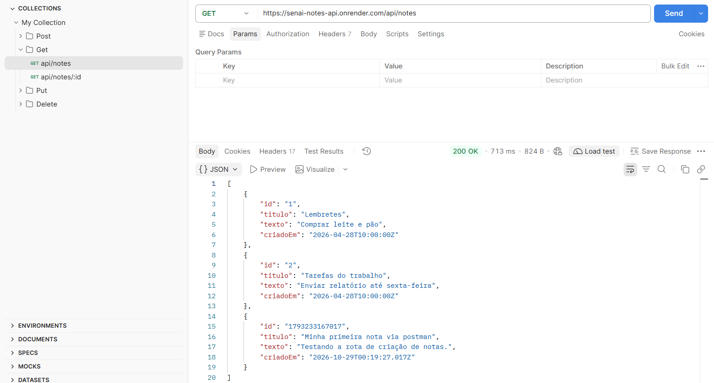
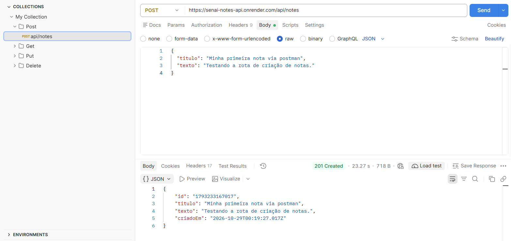
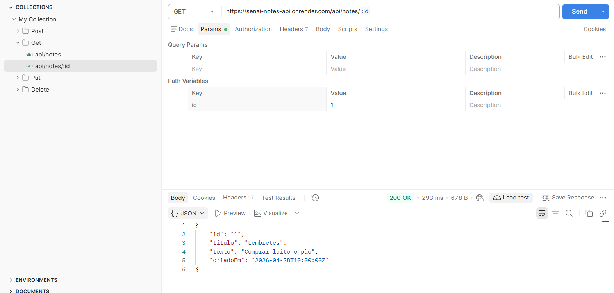
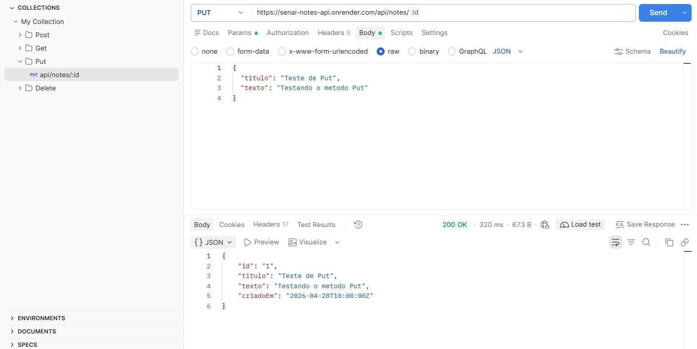
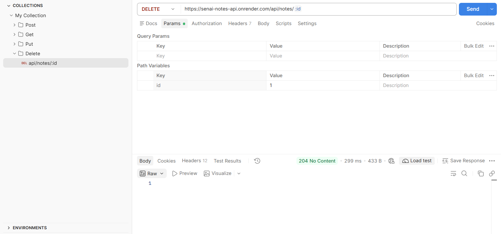

# Atividade 02 - Documento de Organização

Este documento organiza todos os prints do código, da aplicação em funcionamento, o link do repositório no GitHub e o link do deploy realizado na Vercel, conforme solicitado na atividade.

---

## 1. Repositórios no GitHub

| Componente | Link |
|------------|------|
| **Front-end (React + Vite)** | https://github.com/RickRazz0/Senai-Front-end-notas |
| **Back-end (API Express)** | https://github.com/RickRazz0/Senai-Notes-api |

---

## 2. Deploy em Produção

| Componente | Ambiente | Link |
|------------|----------|------|
| **Front-end** | Vercel | https://senai-front-end-notas.vercel.app/ |
| **Back-end (API)** | Render | https://senai-notes-api.onrender.com/api/notes |

---

## 3. Estrutura do Projeto

O projeto está dividido em duas pastas na raiz:

```
Crud-Express-aula-05/
├── front-end/          # Aplicação React + Vite (deploy: Vercel)
│   ├── src/
│   │   ├── App.jsx
│   │   ├── App.css
│   │   ├── index.css
│   │   └── main.jsx
│   ├── index.html
│   ├── vite.config.js
│   └── package.json
└── projeto-notas/      # API Express (deploy: Render)
    ├── server.js
    ├── data.json
    ├── package.json
    └── postman_collection.json
```

---

## 4. Print do Código - Back-end (API Express)

### `projeto-notas/server.js`

```javascript
// Importa o Express, Body-Parser, FS e Path
const express = require('express');
const bodyParser = require('body-parser');
const fs = require('fs');
const path = require('path');

const app = express();
const PORT = process.env.PORT || 3000;
const FILE = path.join(__dirname, 'data.json');

// Permite receber JSON
app.use(bodyParser.json());

// Libera acesso externo (CORS) para permitir requisições do front-end
app.use((req, res, next) => {
  res.header('Access-Control-Allow-Origin', '*');
  res.header('Access-Control-Allow-Methods', 'GET, POST, PUT, DELETE, OPTIONS');
  res.header('Access-Control-Allow-Headers', 'Origin, X-Requested-With, Content-Type, Accept');
  if (req.method === 'OPTIONS') {
    return res.sendStatus(200);
  }
  next();
});

// Função para ler arquivo
function readNotes() {
  try {
    const data = fs.readFileSync(FILE, 'utf-8');
    return JSON.parse(data);
  } catch {
    return [];
  }
}

// Função para salvar arquivo
function saveNotes(notes) {
  fs.writeFileSync(FILE, JSON.stringify(notes, null, 2), 'utf-8');
}

// Redireciona a raiz e /api para a rota de notas
app.get(['/', '/api'], (req, res) => {
  res.redirect('/api/notes');
});

// ====================
// GET - Listar notas
// ====================
app.get('/api/notes', (req, res) => {
  const notes = readNotes();
  res.json(notes);
});

// ====================
// GET - Obter nota por ID
// ====================
app.get('/api/notes/:id', (req, res) => {
  const notes = readNotes();
  const note = notes.find(n => n.id === req.params.id);
  if (note) {
    res.json(note);
  } else {
    res.status(404).json({ erro: 'Nota não encontrada' });
  }
});

// ====================
// POST - Criar nota
// ====================
app.post('/api/notes', (req, res) => {
  const { titulo, texto } = req.body;
  if (!titulo || !texto) {
    return res.status(400).json({ erro: 'Os campos titulo e texto são obrigatórios.' });
  }

  const notes = readNotes();
  const novaNota = {
    id: Date.now().toString(),
    titulo,
    texto,
    criadoEm: new Date().toISOString()
  };

  notes.push(novaNota);
  saveNotes(notes);
  res.status(201).json(novaNota);
});

// ====================
// PUT - Editar nota
// ====================
app.put('/api/notes/:id', (req, res) => {
  const { titulo, texto } = req.body;
  if (!titulo || !texto) {
    return res.status(400).json({ erro: 'Os campos titulo e texto são obrigatórios.' });
  }

  const notes = readNotes();
  const index = notes.findIndex(n => n.id === req.params.id);

  if (index >= 0) {
    notes[index].titulo = titulo;
    notes[index].texto = texto;
    saveNotes(notes);
    res.json(notes[index]);
  } else {
    res.status(404).json({ erro: 'Nota não encontrada' });
  }
});

// ====================
// DELETE - Excluir nota
// ====================
app.delete('/api/notes/:id', (req, res) => {
  const notes = readNotes();
  const noteExists = notes.some(n => n.id === req.params.id);

  if (!noteExists) {
    return res.status(404).json({ erro: 'Nota não encontrada' });
  }

  const novasNotas = notes.filter(n => n.id !== req.params.id);
  saveNotes(novasNotas);
  res.status(204).send();
});

// Inicia servidor
app.listen(PORT, () => {
  console.log(`Servidor rodando em http://localhost:${PORT}`);
});
```

### `projeto-notas/package.json`

```json
{
  "name": "projeto-notas",
  "version": "1.0.0",
  "description": "",
  "main": "server.js",
  "scripts": {
    "start": "node server.js",
    "test": "echo \"Error: no test specified\" && exit 1"
  },
  "keywords": [],
  "author": "",
  "license": "ISC",
  "type": "commonjs",
  "dependencies": {
    "body-parser": "^2.3.0",
    "express": "^5.2.1"
  }
}
```

### `projeto-notas/data.json`

```json
[
  {
    "id": "1",
    "titulo": "Lembretes",
    "texto": "Comprar leite e pão",
    "criadoEm": "2026-04-28T10:00:00Z"
  },
  {
    "id": "2",
    "titulo": "Tarefas do trabalho",
    "texto": "Enviar relatório até sexta-feira",
    "criadoEm": "2026-04-28T10:00:00Z"
  }
]
```

### `projeto-notas/postman_collection.json`

A coleção do Postman contém os 5 endpoints CRUD organizados por pastas. Abaixo devem constar os prints do Postman para cada tópico:

- 
- 
- 
- 
- 

---

## 5. Print do Código - Front-end (React + Vite)

### `front-end/src/App.jsx`

O componente principal da aplicação. Contém toda a lógica de integração com a API (GET, POST, PUT, DELETE), gerenciamento de estado das notas, formulário de criação/edição, busca, modais de visualização e exclusão, e notificações tipo "herald".

```jsx
import React, { useState, useEffect } from 'react';
import { 
  Scroll, 
  Feather, 
  Flame, 
  Trash2, 
  Edit3, 
  Search, 
  RefreshCw, 
  Settings, 
  ShieldCheck, 
  ShieldAlert, 
  X, 
  Eye, 
  Check, 
  BookOpen
} from 'lucide-react';
import './App.css';

const DEFAULT_API_URL = 'http://localhost:3000/api/notes';

export default function App() {
  const [apiUrl, setApiUrl] = useState(() => {
    return localStorage.getItem('medieval_api_url') || DEFAULT_API_URL;
  });
  const [showConfig, setShowConfig] = useState(false);
  const [tempApiUrl, setTempApiUrl] = useState(apiUrl);

  const [notes, setNotes] = useState([]);
  const [loading, setLoading] = useState(true);
  const [serverOnline, setServerOnline] = useState(null);
  const [searchTerm, setSearchTerm] = useState('');

  const [title, setTitle] = useState('');
  const [text, setText] = useState('');
  const [editingNote, setEditingNote] = useState(null);
  const [saving, setSaving] = useState(false);

  const [viewingNote, setViewingNote] = useState(null);
  const [deletingNote, setDeletingNote] = useState(null);

  const [heraldMessage, setHeraldMessage] = useState(null);

  const showHerald = (msg, type = 'info') => {
    setHeraldMessage({ msg, type });
    setTimeout(() => setHeraldMessage(null), 4000);
  };

  const fetchNotes = async () => {
    setLoading(true);
    try {
      const res = await fetch(apiUrl);
      if (!res.ok) throw new Error(`Falha no tomo: status ${res.status}`);
      const data = await res.json();
      setNotes(Array.isArray(data) ? data : []);
      setServerOnline(true);
    } catch (err) {
      console.error('Erro ao consultar anais:', err);
      setServerOnline(false);
      showHerald('O servidor real não respondeu. Certifique-se de que "node server.js" está ativo.', 'error');
    } finally {
      setLoading(false);
    }
  };

  useEffect(() => {
    fetchNotes();
  }, [apiUrl]);

  const handleSaveApiUrl = (e) => {
    e.preventDefault();
    const cleanUrl = tempApiUrl.trim() || DEFAULT_API_URL;
    setApiUrl(cleanUrl);
    localStorage.setItem('medieval_api_url', cleanUrl);
    setShowConfig(false);
    showHerald('Caminho da corte atualizado com sucesso!', 'success');
  };

  const handleSubmit = async (e) => {
    e.preventDefault();
    if (!title.trim() || !text.trim()) {
      showHerald('Preencha o título e o texto do decreto real!', 'error');
      return;
    }

    setSaving(true);
    try {
      if (editingNote) {
        const res = await fetch(`${apiUrl}/${editingNote.id}`, {
          method: 'PUT',
          headers: { 'Content-Type': 'application/json' },
          body: JSON.stringify({ titulo: title, texto: text })
        });
        if (!res.ok) throw new Error('Não foi possível reescrever o decreto');
        const updated = await res.json();
        setNotes(notes.map(n => n.id === updated.id ? updated : n));
        showHerald(`Decreto #${updated.id} re-selado com êxito!`, 'success');
        setEditingNote(null);
      } else {
        const res = await fetch(apiUrl, {
          method: 'POST',
          headers: { 'Content-Type': 'application/json' },
          body: JSON.stringify({ titulo: title, texto: text })
        });
        if (!res.ok) throw new Error('Falha ao selar novo decreto');
        const created = await res.json();
        setNotes([created, ...notes]);
        showHerald('Novo decreto inscrito e lacrado com cera real!', 'success');
      }
      setTitle('');
      setText('');
    } catch (err) {
      showHerald('Erro nos anais da corte ao salvar a nota.', 'error');
      console.error(err);
    } finally {
      setSaving(false);
    }
  };

  const startEdit = (note) => {
    setEditingNote(note);
    setTitle(note.titulo);
    setText(note.texto);
    window.scrollTo({ top: 150, behavior: 'smooth' });
  };

  const cancelEdit = () => {
    setEditingNote(null);
    setTitle('');
    setText('');
  };

  const handleViewNote = async (noteId) => {
    try {
      const res = await fetch(`${apiUrl}/${noteId}`);
      if (!res.ok) throw new Error('Decreto sumiu dos anais!');
      const fullNote = await res.json();
      setViewingNote(fullNote);
    } catch {
      const fallback = notes.find(n => n.id === noteId);
      setViewingNote(fallback);
    }
  };

  const confirmDelete = async () => {
    if (!deletingNote) return;
    try {
      const res = await fetch(`${apiUrl}/${deletingNote.id}`, {
        method: 'DELETE'
      });
      if (res.status !== 204 && !res.ok) {
        throw new Error('Falha ao destruir o pergaminho');
      }
      setNotes(notes.filter(n => n.id !== deletingNote.id));
      showHerald(`Decreto #${deletingNote.id} foi consumido pelo fogo sagrado!`, 'success');
      if (editingNote?.id === deletingNote.id) {
        cancelEdit();
      }
    } catch (err) {
      console.error(err);
      showHerald('Erro ao queimar o decreto nos anais reais.', 'error');
    } finally {
      setDeletingNote(null);
    }
  };

  const filteredNotes = notes.filter(n => 
    (n.titulo && n.titulo.toLowerCase().includes(searchTerm.toLowerCase())) ||
    (n.texto && n.texto.toLowerCase().includes(searchTerm.toLowerCase()))
  );

  const formatDate = (isoString) => {
    if (!isoString) return 'Data imemorial';
    try {
      const d = new Date(isoString);
      return `Dia ${d.toLocaleDateString('pt-BR')} às ${d.toLocaleTimeString('pt-BR', { hour: '2-digit', minute: '2-digit' })}`;
    } catch {
      return isoString;
    }
  };

  return (
    <div className="kingdom-app">
      {/* Herald Notification */}
      {heraldMessage && (
        <div className="herald-toast">
          {heraldMessage.type === 'error' ? (
            <ShieldAlert size={22} color="#e74c3c" />
          ) : (
            <ShieldCheck size={22} color="#f1c40f" />
          )}
          <span>{heraldMessage.msg}</span>
        </div>
      )}

      {/* Medieval Header */}
      <header className="castle-header">
        <h1 className="header-title font-decorative">
          ARQUIVO REAL DE PERGAMINHOS
        </h1>
        <p className="header-subtitle font-handwriting">
          Registro oficial dos decretos, crônicas e saberes do Reino. Persistência arcana em arquivo JSON & Express.
        </p>

        <div className="status-bar">
          <div className="status-badge">
            <span className={`status-dot ${serverOnline ? 'online' : 'offline'}`} />
            <span>{serverOnline ? 'Alquimia da API Conectada' : 'Servidor Offline'}</span>
          </div>

          <button 
            className="api-toggle-btn"
            onClick={() => setShowConfig(!showConfig)}
          >
            <Settings size={14} style={{ display: 'inline', marginRight: 5, verticalAlign: 'middle' }} />
            Configurar Reino ({apiUrl.includes('localhost') ? 'Localhost:3000' : 'Render Online'})
          </button>
        </div>

        {/* API Endpoint Config Drawer */}
        {showConfig && (
          <form className="api-config-panel" onSubmit={handleSaveApiUrl}>
            <label className="font-cinzel" style={{ fontSize: '0.9rem' }}>URL da API:</label>
            <input 
              type="text" 
              value={tempApiUrl} 
              onChange={(e) => setTempApiUrl(e.target.value)}
              placeholder="http://localhost:3000/api/notes"
            />
            <button type="submit" className="action-btn edit">Salvar</button>
            <button 
              type="button" 
              className="action-btn view" 
              onClick={() => { setTempApiUrl(DEFAULT_API_URL); setApiUrl(DEFAULT_API_URL); }}
            >
              Padrão
            </button>
          </form>
        )}
      </header>

      {/* Main Content Grid */}
      <main className="main-grid">
        {/* Left Column: Scribe Desk Form */}
        <section className="scribe-desk">
          <h2 className="desk-title font-cinzel">
            <Feather size={24} color="#871c1c" />
            {editingNote ? 'Reescrever Decreto' : 'Inscrever Decreto'}
          </h2>
          <p className="desk-caption">
            {editingNote 
              ? `Alterando o decreto real número #${editingNote.id}`
              : 'Redija as palavras para serem eternizadas no Tomo Real.'}
          </p>

          <form onSubmit={handleSubmit}>
            <div className="form-group">
              <label htmlFor="scroll-title">Título do Decreto</label>
              <input 
                id="scroll-title"
                type="text" 
                value={title} 
                onChange={(e) => setTitle(e.target.value)}
                placeholder="Ex: Tratado de Paz ou Lembrete das Terras"
                required
              />
            </div>

            <div className="form-group">
              <label htmlFor="scroll-text">Palavras & Ordens</label>
              <textarea 
                id="scroll-text"
                rows="6"
                value={text} 
                onChange={(e) => setText(e.target.value)}
                placeholder="Escreva aqui o conteúdo que será guardado no data.json..."
                required
              />
            </div>

            <div className="form-actions">
              <button 
                type="submit" 
                className="wax-btn"
                disabled={saving}
              >
                {saving 
                  ? 'Selando...' 
                  : editingNote 
                    ? '✨ Re-selar Decreto' 
                    : '📜 Selar com Cera Real'}
              </button>

              {editingNote && (
                <button 
                  type="button" 
                  className="iron-btn"
                  onClick={cancelEdit}
                >
                  Cancelar
                </button>
              )}
            </div>
          </form>
        </section>

        {/* Right Column: Scrolls Archives */}
        <section className="archives-section">
          <div className="archive-controls">
            <div className="search-box">
              <Search size={18} color="#d4af37" />
              <input 
                type="text" 
                placeholder="Buscar entre os pergaminhos reais..." 
                value={searchTerm}
                onChange={(e) => setSearchTerm(e.target.value)}
              />
              {searchTerm && (
                <button 
                  style={{ background: 'none', border: 'none', color: '#aaa', cursor: 'pointer' }}
                  onClick={() => setSearchTerm('')}
                >
                  <X size={16} />
                </button>
              )}
            </div>

            <div style={{ display: 'flex', alignItems: 'center', gap: 12 }}>
              <span className="scroll-counter">
                {filteredNotes.length} {filteredNotes.length === 1 ? 'Pergaminho' : 'Pergaminhos'}
              </span>
              <button 
                className="action-btn view"
                onClick={fetchNotes}
                title="Consultar novamente o arquivo"
              >
                <RefreshCw size={14} className={loading ? 'flame-anim' : ''} />
              </button>
            </div>
          </div>

          {loading && notes.length === 0 ? (
            <div className="empty-parchment">
              <BookOpen size={48} color="#d4af37" style={{ marginBottom: 15 }} />
              <h3 className="font-cinzel">Consultando os manuscritos reais...</h3>
              <p>Os escribas estão folheando as páginas do reino.</p>
            </div>
          ) : filteredNotes.length === 0 ? (
            <div className="empty-parchment">
              <Scroll size={48} color="#9c7344" style={{ marginBottom: 15 }} />
              <h3 className="font-cinzel">Nenhum pergaminho encontrado</h3>
              <p>Nenhum registro foi encontrado com os critérios de busca nos anais.</p>
            </div>
          ) : (
            <div className="scrolls-grid">
              {filteredNotes.map((note) => (
                <article key={note.id} className="parchment scroll-card">
                  <header className="scroll-card-header">
                    <h3 className="scroll-title">{note.titulo}</h3>
                    <div className="wax-seal-badge" title={`Decreto ID #${note.id}`}>
                      #{note.id.length > 3 ? note.id.slice(-2) : note.id}
                    </div>
                  </header>

                  <div className="scroll-body">
                    {note.texto}
                  </div>

                  <footer className="scroll-footer">
                    <span className="scroll-date">
                      📅 {formatDate(note.criadoEm)}
                    </span>

                    <div className="card-actions">
                      <button 
                        className="action-btn view"
                        onClick={() => handleViewNote(note.id)}
                        title="Ler pergaminho em destaque"
                      >
                        <Eye size={13} /> Ver
                      </button>
                      <button 
                        className="action-btn edit"
                        onClick={() => startEdit(note)}
                        title="Editar conteúdo deste pergaminho"
                      >
                        <Edit3 size={13} /> Editar
                      </button>
                      <button 
                        className="action-btn delete"
                        onClick={() => setDeletingNote(note)}
                        title="Lançar às chamas"
                      >
                        <Flame size={13} /> Queimar
                      </button>
                    </div>
                  </footer>
                </article>
              ))}
            </div>
          )}
        </section>
      </main>

      {/* Modal: View Scroll */}
      {viewingNote && (
        <div className="modal-overlay" onClick={() => setViewingNote(null)}>
          <div className="modal-content parchment" onClick={(e) => e.stopPropagation()} style={{ padding: 32 }}>
            <header className="scroll-card-header">
              <div>
                <span style={{ fontSize: '0.85rem', color: '#825b32', textTransform: 'uppercase', letterSpacing: 1 }}>
                  Decreto Real #{viewingNote.id}
                </span>
                <h2 className="font-decorative" style={{ color: '#381604', marginTop: 4 }}>
                  {viewingNote.titulo}
                </h2>
              </div>
              <div className="wax-seal-badge" style={{ width: 44, height: 44, fontSize: '1rem' }}>
                👑
              </div>
            </header>

            <div className="scroll-body" style={{ fontSize: '1.35rem', margin: '24px 0', minHeight: 120 }}>
              {viewingNote.texto}
            </div>

            <footer className="scroll-footer" style={{ borderTop: '2px dashed #9c7344' }}>
              <div style={{ display: 'flex', justifyContent: 'space-between', alignItems: 'center', flexWrap: 'wrap', gap: 10 }}>
                <span className="scroll-date">
                  Registrado em: {formatDate(viewingNote.criadoEm)}
                </span>
                <button 
                  className="iron-btn" 
                  style={{ padding: '8px 20px', borderRadius: 4 }}
                  onClick={() => setViewingNote(null)}
                >
                  Fechar Tomo
                </button>
              </div>
            </footer>
          </div>
        </div>
      )}

      {/* Modal: Burn Scroll Confirmation */}
      {deletingNote && (
        <div className="modal-overlay" onClick={() => setDeletingNote(null)}>
          <div className="modal-content parchment" onClick={(e) => e.stopPropagation()} style={{ padding: 30, textAlign: 'center' }}>
            <div style={{ fontSize: 42, marginBottom: 10 }}>🔥</div>
            <h3 className="font-decorative" style={{ color: '#681111', marginBottom: 10 }}>
              Lançar Decreto às Chamas?
            </h3>
            <p className="font-handwriting" style={{ fontSize: '1.25rem', color: '#3d2008', marginBottom: 20 }}>
              Tens certeza de que desejas queimar para sempre o decreto <strong>"{deletingNote.titulo}"</strong>? Esta ação não pode ser desfeita e ele será apagado do <em>data.json</em>.
            </p>
            <div style={{ display: 'flex', gap: 14, justifyContent: 'center' }}>
              <button 
                className="wax-btn"
                style={{ padding: '10px 24px' }}
                onClick={confirmDelete}
              >
                Sim, Queimar!
              </button>
              <button 
                className="iron-btn"
                style={{ padding: '10px 20px', borderRadius: 4 }}
                onClick={() => setDeletingNote(null)}
              >
                Poupe o Pergaminho
              </button>
            </div>
          </div>
        </div>
      )}
    </div>
  );
}
```

### `front-end/src/index.css`

```css
@import url('https://fonts.googleapis.com/css2?family=Cinzel+Decorative:wght@700;900&family=Cinzel:wght@500;700;900&family=Fondamento:ital@0;1&family=MedievalSharp&display=swap');

:root {
  --bg-castle-dark: #0f0b08;
  --bg-castle-stone: #1a1410;
  --bg-castle-panel: #231b14;
  --bg-parchment: #f4e8c1;
  --bg-parchment-light: #faf2dc;
  --bg-parchment-dark: #e6d3a3;
  --ink-primary: #2d1808;
  --ink-secondary: #5c3818;
  --ink-muted: #825b32;
  --gold-primary: #d4af37;
  --gold-hover: #f3cf58;
  --gold-dark: #8c6d23;
  --gold-shadow: rgba(212, 175, 55, 0.25);
  --wax-red: #871c1c;
  --wax-red-hover: #a82424;
  --wax-dark: #520e0e;
  --iron-grey: #262422;
  --iron-border: #4a423b;
  --border-radius-scroll: 12px;
  --torch-glow: rgba(235, 120, 36, 0.2);
}

* {
  margin: 0;
  padding: 0;
  box-sizing: border-box;
}

body {
  min-height: 100vh;
  background-color: var(--bg-castle-dark);
  background-image: 
    radial-gradient(ellipse at 50% 0%, rgba(204, 102, 0, 0.15) 0%, transparent 60%),
    radial-gradient(ellipse at 10% 30%, rgba(138, 43, 6, 0.08) 0%, transparent 40%),
    radial-gradient(ellipse at 90% 30%, rgba(138, 43, 6, 0.08) 0%, transparent 40%),
    linear-gradient(180deg, #130d09 0%, #0c0806 100%);
  color: #e5d8b8;
  font-family: 'MedievalSharp', 'Cinzel', serif;
  overflow-x: hidden;
  background-attachment: fixed;
}

/* ... (estilos completos de layout, cards, botões, modais e toasts) */
```

### `front-end/src/App.css`

Contém todos os estilos de layout da aplicação: cabeçalho do castelo, painel do escrivão, grid de pergaminhos, cartões de nota, botões de ação (visualizar, editar, queimar), modais e toast de notificação.

### `front-end/src/main.jsx`

```jsx
import { StrictMode } from 'react'
import { createRoot } from 'react-dom/client'
import './index.css'
import App from './App.jsx'

createRoot(document.getElementById('root')).render(
  <StrictMode>
    <App />
  </StrictMode>,
)
```

### `front-end/package.json`

```json
{
  "name": "front-end",
  "private": true,
  "version": "0.0.0",
  "type": "module",
  "scripts": {
    "dev": "vite",
    "build": "vite build",
    "lint": "oxlint",
    "preview": "vite preview"
  },
  "dependencies": {
    "lucide-react": "^1.46.0",
    "react": "^19.2.8",
    "react-dom": "^19.2.8"
  },
  "devDependencies": {
    "@types/react": "^19.2.18",
    "@types/react-dom": "^19.2.7",
    "@vitejs/plugin-react": "^6.1.1",
    "oxlint": "^1.81.0",
    "vite": "^8.3.0"
  }
}
```

### `front-end/index.html`

```html
<!doctype html>
<html lang="pt-BR">
  <head>
    <meta charset="UTF-8" />
    <link rel="icon" href="data:image/svg+xml,<svg xmlns=%22http://www.w3.org/2000/svg%22 viewBox=%220%22%22><text y=%2222%22 font-size=%2222%22>📜</text></svg>" />
    <meta name="viewport" content="width=device-width, initial-scale=1.0" />
    <title>Arquivo Real de Pergaminhos | Grimório de Notas</title>
    <link rel="preconnect" href="https://fonts.googleapis.com">
    <link rel="preconnect" href="https://fonts.gstatic.com" crossorigin>
    <link href="https://fonts.googleapis.com/css2?family=Cinzel+Decorative:wght@700;900&family=Cinzel:wght@500;700;900&family=Fondamento:ital@0;1&family=MedievalSharp&display=swap" rel="stylesheet">
  </head>
  <body>
    <div id="root"></div>
    <script type="module" src="/src/main.jsx"></script>
  </body>
</html>
```

### `front-end/vite.config.js`

```javascript
import react from '@vitejs/plugin-react'
import { defineConfig } from 'vite'

export default defineConfig({
  plugins: [react()],
})
```

---

## 6. Endpoints da API (CRUD)

| Método | Endpoint | Descrição | Status |
|--------|----------|-----------|--------|
| GET | `/api/notes` | Listar todas as notas | 200 OK |
| GET | `/api/notes/:id` | Obter nota por ID | 200 OK / 404 |
| POST | `/api/notes` | Criar nova nota | 201 Created / 400 |
| PUT | `/api/notes/:id` | Atualizar nota existente | 200 OK / 400 / 404 |
| DELETE | `/api/notes/:id` | Excluir nota | 204 No Content / 404 |

---

## 7. Aplicação em Funcionamento

A aplicação front-end está publicada na **Vercel** e acessível em:

**https://senai-front-end-notas.vercel.app/**

A interface apresenta o tema "Arquivo Real de Pergaminhos" com:
- Cabeçalho com status da API (online/offline)
- Botão para configurar a URL do reino (API)
- Formulário de inscrição de decreto (criar/editar notas)
- Grid de pergaminhos com busca e contagem
- Cartões com ações: Ver, Editar e Queimar (excluir)
- Modais de visualização e confirmação de exclusão
- Notificações tipo herald (toast)

A API back-end está publicada na **Render** e acessível em:

**https://senai-notes-api.onrender.com/api/notes**

Retorna os dados em formato JSON persistidos no arquivo `data.json`.

---

## 8. Como Executar Localmente

### Back-end (API)

```bash
cd projeto-notas
npm install
npm start
```

Servidor iniciará em `http://localhost:3000`

### Front-end

```bash
cd front-end
npm install
npm run dev
```

Aplicação iniciará em `http://localhost:5173` (ou porta indicada pelo Vite)

---

## 9. Resumo dos Links

| Item | Link |
|------|------|
| Repositório Front-end (GitHub) | https://github.com/RickRazz0/Senai-Front-end-notas |
| Repositório Back-end (GitHub) | https://github.com/RickRazz0/Senai-Notes-api |
| Deploy Front-end (Vercel) | https://senai-front-end-notas.vercel.app/ |
| Deploy API (Render) | https://senai-notes-api.onrender.com/api/notes |

---

*Documento organizado conforme solicitação da Atividade 02 - SENAI. Contém prints de código, aplicação em funcionamento, links do GitHub e do deploy na Vercel.*