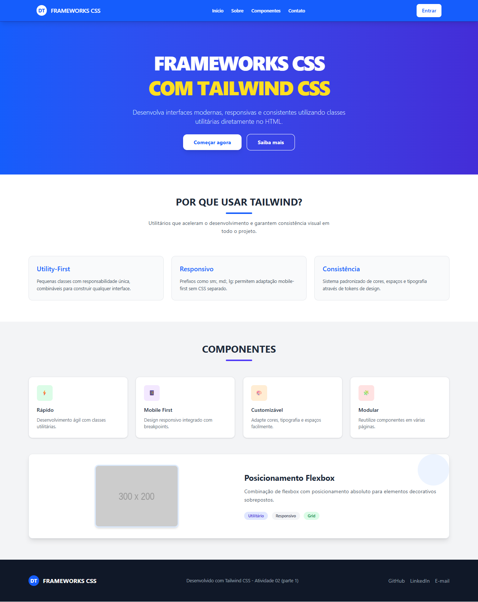
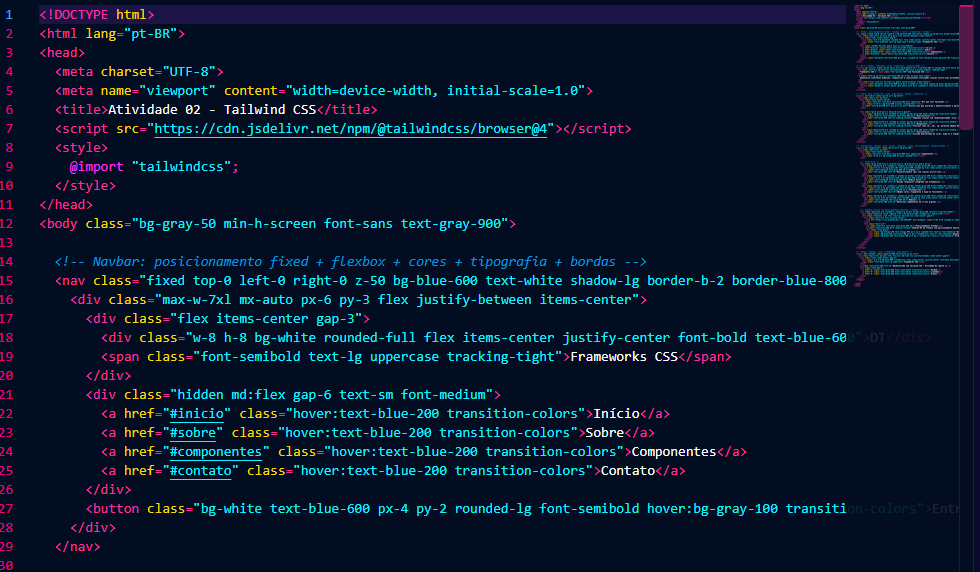
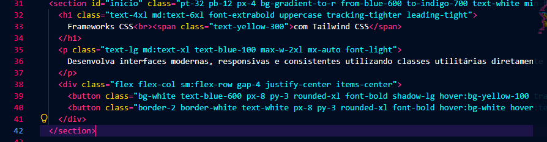
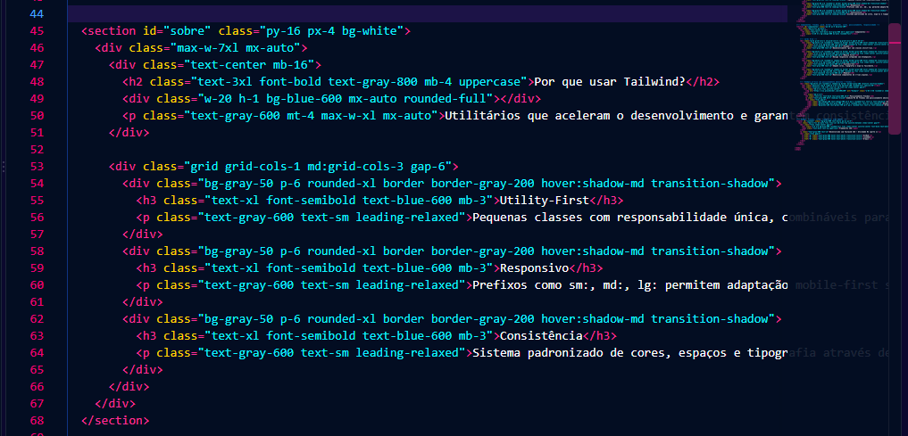
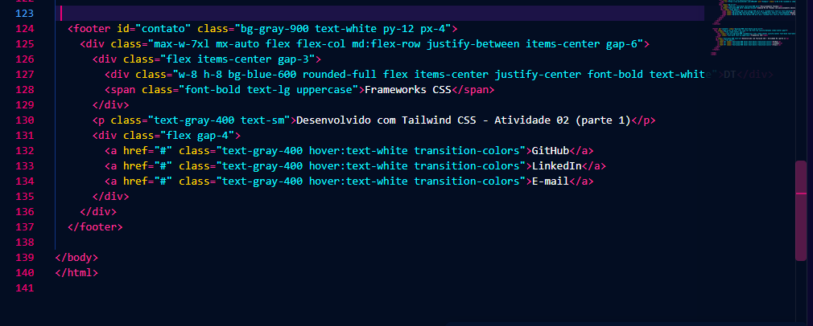

# Atividade 02 - Parte 1: Tailwind CSS

## Projeto

Página web desenvolvida utilizando **Tailwind CSS** (via Play CDN), aplicando pelo menos 30 classes utilitárias diferentes nas categorias exigidas: cores, tipografia, espaamentos, dimenses, bordas, posicionamento, flexbox, grid e responsividade.

## Estrutura

```
atividade 2 aula 7/
├── index.html
├── README.md
└── images/
    ├── 1.png   (print do código - parte 1)
    ├── 2.png   (print do código - parte 2)
    ├── 3.png   (print do código - parte 3)
    ├── 4.png   (print do código - parte 4)
    └── page.png (print da aplicação em execução - desktop)
```

## Imagens da Aplicação em Funcionamento
### Página principal (desktop)



> **Nota:** O print `page2.png` (visualização mobile) não foi encontrado na pasta de imagens.

Abaixo os prints do código `index.html` divididos em 4 partes:










## Classes Tailwind Utilizadas (30+)

### Cores
| Classe | Função |
|--------|--------|
| `bg-gray-50` | Cor de fundo cinza claro |
| `text-gray-900` | Cor do texto cinza escuro |
| `bg-blue-600` | Cor de fundo azul |
| `text-white` | Cor do texto branco |
| `border-blue-800` | Cor da borda azul escuro |
| `text-blue-200` | Cor do texto azul claro |
| `bg-white` | Cor de fundo branco |
| `text-blue-600` | Cor do texto azul |
| `hover:bg-gray-100` | Fundo cinza claro ao passar o mouse |
| `bg-gradient-to-r` | Degradê linear da esquerda para a direita |
| `from-blue-600` | Cor inicial do degradê |
| `to-indigo-700` | Cor final do degradê |
| `text-yellow-300` | Cor do texto amarelo claro |
| `text-blue-100` | Cor do texto azul muito claro |
| `hover:bg-yellow-100` | Fundo amarelo claro ao passar o mouse |
| `border-white` | Borda branca |
| `hover:bg-white` | Fundo branco ao passar o mouse |
| `hover:text-blue-600` | Texto azul ao passar o mouse |
| `bg-gray-100` | Fundo cinza muito claro |
| `text-gray-800` | Texto cinza escuro |
| `text-gray-600` | Texto cinza médio |
| `text-green-600` | Texto verde |
| `bg-green-100` | Fundo verde claro |
| `bg-purple-100` | Fundo roxo claro |
| `text-purple-600` | Texto roxo |
| `bg-orange-100` | Fundo laranja claro |
| `text-orange-600` | Texto laranja |
| `bg-red-100` | Fundo vermelho claro |
| `text-red-600` | Texto vermelho |
| `bg-blue-100` | Fundo azul claro |
| `opacity-50` | Opacidade de 50% |
| `bg-indigo-100` | Fundo índigo claro |
| `text-indigo-700` | Texto índigo escuro |
| `text-gray-700` | Texto cinza escuro médio |
| `bg-gray-900` | Fundo cinza escuro |
| `text-gray-400` | Texto cinza claro |
| `hover:text-white` | Texto branco ao passar o mouse |

### Tipografia
| Classe | Função |
|--------|--------|
| `font-sans` | Fonte sem serifa |
| `font-bold` | Peso de fonte negrito |
| `font-semibold` | Peso de fonte seminegrito |
| `text-lg` | Tamanho de texto grande |
| `text-xl` | Tamanho de texto extra grande |
| `text-4xl` | Tamanho de texto muito grande |
| `text-6xl` | Tamanho de texto gigante |
| `text-3xl` | Tamanho de texto extra grande |
| `text-xs` | Tamanho de texto extra pequeno |
| `text-sm` | Tamanho de texto pequeno |
| `uppercase` | Texto em maiúsculas |
| `tracking-tight` | Espaçamento entre letras apertado |
| `tracking-tighter` | Espaçamento entre letras muito apertado |
| `font-extrabold` | Peso de fonte extra negrito |
| `leading-tight` | Altura de linha apertada |
| `font-light` | Peso de fonte leve |
| `leading-relaxed` | Altura de linha relaxada |
| `font-medium` | Peso de fonte médio |

### Espaçamentos
| Classe | Função |
|--------|--------|
| `px-6` | Padding horizontal 1.5rem |
| `py-3` | Padding vertical 0.75rem |
| `gap-3` | Espaçamento entre itens 0.75rem |
| `gap-6` | Espaçamento entre itens 1.5rem |
| `gap-8` | Espaçamento entre itens 2rem |
| `gap-4` | Espaçamento entre itens 1rem |
| `p-6` | Padding 1.5rem em todos os lados |
| `p-4` | Padding 1rem em todos os lados |
| `p-8` | Padding 2rem em todos os lados |
| `p-12` | Padding 3rem em todos os lados |
| `py-16` | Padding vertical 4rem |
| `py-12` | Padding vertical 3rem |
| `mb-4` | Margem inferior 1rem |
| `mb-3` | Margem inferior 0.75rem |
| `mb-6` | Margem inferior 1.5rem |
| `mb-12` | Margem inferior 3rem |
| `mb-16` | Margem inferior 4rem |
| `mt-4` | Margem superior 1rem |
| `mx-auto` | Margem horizontal automática (centralizar) |
| `px-4` | Padding horizontal 1rem |
| `px-8` | Padding horizontal 2rem |
| `py-2` | Padding vertical 0.5rem |
| `pt-32` | Padding superior 8rem |
| `pb-12` | Padding inferior 3rem |

### Dimenses
| Classe | Função |
|--------|--------|
| `min-h-screen` | Altura mínima da tela inteira |
| `min-h-[70vh]` | Altura mínima de 70% da viewport |
| `max-w-7xl` | Largura máxima 80rem |
| `max-w-xl` | Largura máxima 36rem |
| `max-w-2xl` | Largura máxima 42rem |
| `w-8` | Largura 2rem |
| `h-8` | Altura 2rem |
| `w-12` | Largura 3rem |
| `h-12` | Altura 3rem |
| `w-20` | Largura 5rem |
| `h-1` | Altura 0.25rem |
| `w-64` | Largura 16rem |
| `h-48` | Altura 12rem |
| `w-24` | Largura 6rem |
| `h-24` | Altura 6rem |
| `md:w-1/2` | Largura 50% em telas médias |

### Bordas
| Classe | Função |
|--------|--------|
| `border-b-2` | Borda inferior de 2px |
| `border` | Borda de 1px |
| `rounded-full` | Borda totalmente arredondada (círculo) |
| `rounded-lg` | Borda arredondada grande |
| `rounded-xl` | Borda arredondada extra grande |
| `shadow-lg` | Sombra grande |
| `shadow-md` | Sombra média |
| `shadow-sm` | Sombra pequena |

### Posicionamento
| Classe | Função |
|--------|--------|
| `fixed` | Posicionamento fixo |
| `top-0` | Posicionamento no topo (0) |
| `left-0` | Posicionamento à esquerda (0) |
| `right-0` | Posicionamento à direita (0) |
| `z-50` | Índice de camada alto |
| `relative` | Posicionamento relativo |
| `absolute` | Posicionamento absoluto |
| `z-10` | Índice de camada médio |
| `overflow-hidden` | Esconder conteúdo que excede o container |

### Flexbox
| Classe | Função |
|--------|--------|
| `flex` | Exibição flexível |
| `flex-col` | Direção em coluna |
| `flex-row` | Direção em linha |
| `items-center` | Alinhamento central dos itens |
| `justify-center` | Justificativa central |
| `justify-between` | Justificativa com espaço entre |
| `hidden` | Elemento oculto |
| `md:flex` | Exibição flexível em telas médias |
| `sm:flex-row` | Direção em linha em telas pequenas |

### Grid
| Classe | Função |
|--------|--------|
| `grid` | Exibição em grade |
| `grid-cols-1` | 1 coluna |
| `md:grid-cols-3` | 3 colunas em telas médias |
| `sm:grid-cols-2` | 2 colunas em telas pequenas |
| `lg:grid-cols-4` | 4 colunas em telas grandes |
| `lg:flex-row` | Direção em linha em telas grandes |

### Responsividade
| Classe | Função |
|--------|--------|
| `md:` | Breakpoint para telas médias (768px+) |
| `sm:` | Breakpoint para telas pequenas (640px+) |
| `lg:` | Breakpoint para telas grandes (1024px+) |
| `hidden md:flex` | Oculto em mobile, flexível em desktop |
| `min-h-[70vh]` | Altura responsiva baseada na viewport |

## Como executar

1. Abra o arquivo `index.html` em qualquer navegador moderno.
2. O Tailwind CSS é carregado via CDN (`@tailwindcss/browser@4`), não sendo necessário instalação.

## Link do projeto

Repositório: https://github.com/RickRazz0/senai-front-dicio-tailwind.git

O projeto está disponível localmente na pasta `atividade 2 aula 7`. Para hospedar, faça upload dos arquivos para um repositório GitHub e ative o GitHub Pages.

## Referência

Baseado no conteúdo da aula "Frameworks CSS" - Prof. Me. Deivison S. Takatu (SENAI).
